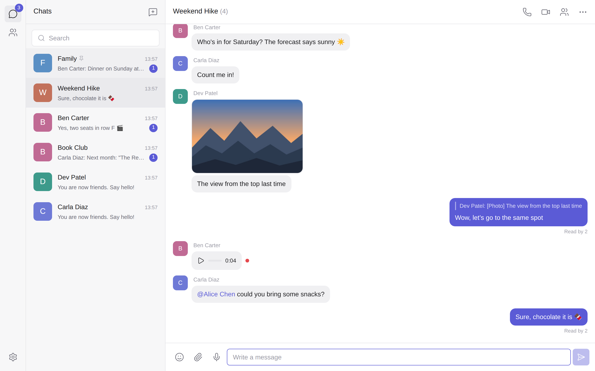
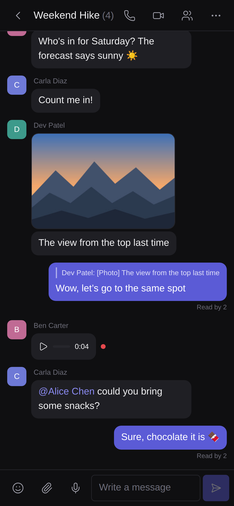
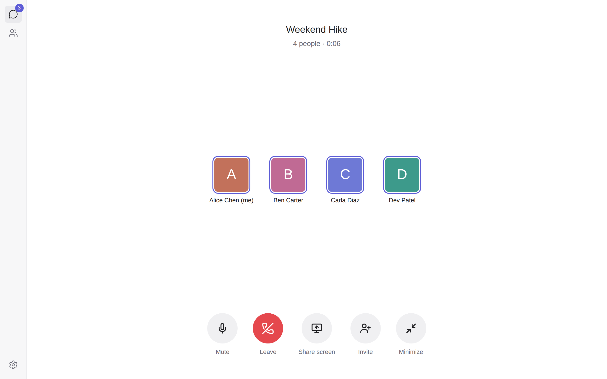
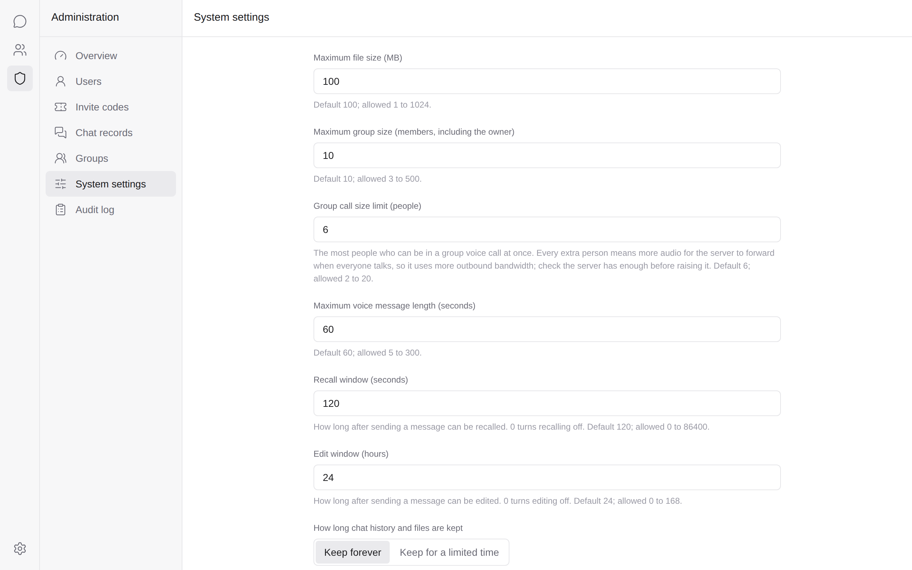

# VibeChat

[中文](README.zh-CN.md)

A self-hosted instant messenger: it runs on your own server, people join with invite codes, and it works in the browser and as a desktop app.
The server is written in Rust, the client in React.

A personal project, maintained when time allows. You're welcome to use it and change it; issues and suggestions are welcome too, but there's no promise of when they'll be answered or fixed.

<p></p>
<p>
  
  
</p>
<p></p>

## What it does

**Chat**

- One-to-one and group chats; text, emoji, pictures (with captions), files, voice messages
- Quoted replies, forwarding, forwarding several messages as one; recalling and editing (within a time set by the administrator); deleting messages or clearing a chat for yourself only
- @mentions and @everyone in groups; read counts; "typing…"
- Pinned chats, searching chat history, all pictures and files of a chat in one place
- One account can be logged in on several devices at once; see them and log the others out

**Calls** (need HTTPS, see the deployment guide)

- One-to-one voice and video calls, with screen sharing from a computer
- Group voice and video calls, with screen sharing

**Groups and contacts**

- Friend requests, remarks, contacts grouped by initial
- A group owner and up to 3 admins: inviting and removing members, muting someone or everyone, approving join requests, a group notice, handing over ownership, dissolving the group

**Administration**

- The administrator creates invite codes; people register with them
- Users, viewing chats, groups, an overview, an audit log
- System settings: file size, group size, voice message length, recall and edit windows, how long messages are kept, call picture quality and bitrates, and more

**Also**

- Chinese and English, light and dark appearance
- Works in Chrome and Safari, on computers and phones
- A macOS desktop app (Electron, for Apple silicon Macs): system notifications for new messages and calls, new versions downloaded from "Settings → About"
- When the server gets a new version, open pages offer to reload and then tell you what changed

## What it doesn't do

- Native phone apps. On phones, use the browser
- Push notifications while the page is closed: notifications only arrive while the page or the desktop app is open
- End-to-end encrypted messages: messages are stored in plain text on your own server (sound and pictures of one-to-one calls are end-to-end encrypted)
- Desktop apps for Windows, Linux or Intel Macs; Firefox

## Deploying

Deploy it with Docker on a server with a public IP address. With an IP address only, you can chat; with a domain name and HTTPS, everything works.
See the [deployment guide](docs/deploy.en.md).

The deployment guide has not yet been followed from scratch on a fresh server; if you run into trouble, please open an issue.

## Screenshots

The screenshots above are made by `./scripts/screenshots` (on the host, at the repository root), which creates sample data and takes them in both languages. Run it again after changing the user interface.

## Layout

```
server/    Rust cargo workspace
  crates/protocol    HTTP and WebSocket message types, exported to TypeScript
  crates/core        Business logic; defines the Store and BlobStore traits
  crates/infra       Implementations of those traits (database, file storage, mail)
  crates/migration   Database migrations
  crates/app         The vibechat-server executable
client/    pnpm workspace
  apps/web           The web app (Vite)
  apps/desktop       The macOS desktop app (Electron)
  packages/protocol  Generated TypeScript types
  packages/core      Connection, sync, state, calls
  packages/ui        React user interface
  e2e                End-to-end tests (Playwright)
deploy/    Dockerfile, compose file and settings for deployment
dev/       Dockerfiles and settings of the development environment
docs/      Deployment guide; screenshots for this README
scripts/   Development scripts
data/      Runtime data during development (SQLite, uploads); not in git
```

Code comments and docs are mostly in Chinese. Comments often mention numbers such as F12 or M2: these are task numbers from development, whose requirement and design documents are not public.

## Development

Every command runs inside the development container; the host only needs Docker (with compose) and git. The environment is defined in the repository:
`compose.yaml` at the root, plus the Dockerfile and the coturn and LiveKit settings in `dev/`.

```bash
# At the repository root: build and start the development container (the first time downloads and compiles a lot)
docker compose up -d --build

# Start the server and the web app together (the first time installs the client dependencies first).
# Rust changes restart the server; client changes reload in place
docker compose exec dev ./scripts/dev

# To try one-to-one and group calls, also start the relay (coturn) and the media server (LiveKit)
docker compose --profile calls up -d
```

| Address | What |
|---|---|
| http://127.0.0.1:8780 | The web app (Vite; forwards `/api`, `/ws`, `/livekit` to the services behind it) |
| http://127.0.0.1:8788 | The Rust server |

Open `127.0.0.1`, not `localhost`: the server checks the origin of requests against `PUBLIC_URL`, and the two are different origins.
The first administrator is `admin` with the initial password `change-me-1` (see `compose.yaml`); it must be changed at the first login.

The development image downloads Rust, Node and watchexec. On a slow network you can download them by hand into `dev/downloads/` first; see the top of `dev/Dockerfile`.

Ports and the address used for calls can be changed in a `.env` file at the repository root (not in git), for example:

```bash
VC_WEB_PORT=8780        # port of the web app
VC_API_PORT=8788        # port of the server
VC_BIND=127.0.0.1       # address the ports are bound to
VC_HOST_IP=192.168.1.10 # address browsers use for the call services; set it to this machine's LAN address to try calls from other computers or phones
```

## Checks and tests

```bash
# Checks before a commit: formatting, lints, types, unit tests. The data layer is tested on SQLite only
docker compose exec dev ./scripts/check

# The full suite (on the host, at the repository root): all of the above, plus the data layer on PostgreSQL
# and the end-to-end tests in Chrome and Safari engines
./scripts/test-all

# End-to-end tests in one engine only
./scripts/test-all --e2e-only --project=webkit

# End-to-end tests only; further arguments go to Playwright
./scripts/test-all --e2e-only -g "avatar"
```

The full suite starts a temporary PostgreSQL, coturn, LiveKit and end-to-end test container, plus a separate server and web app,
and cleans them up afterwards; the running development environment is not affected. Build the end-to-end test image once first: `docker compose --profile test build e2e`.

## Everyday commands

```bash
# After changing server/crates/protocol, regenerate the TypeScript types
docker compose exec dev ./scripts/gen-protocol

# Format the client code
docker compose exec -w /vibechat/client dev pnpm format

# Format the server code
docker compose exec -w /vibechat/server dev cargo fmt
```

Building and packaging the desktop app: see [client/apps/desktop/README.md](client/apps/desktop/README.md) (in Chinese).

## Server settings

The server is configured entirely through environment variables, checked at startup; a bad one is named. An empty value counts as not set.

| Setting | Required | Meaning |
|---|---|---|
| `PUBLIC_URL` | Yes | The address people open in the browser; used to check where requests come from |
| `DATABASE_URL` | Yes | Database connection, starting with `sqlite:` or `postgres:` |
| `FILES_DIR` | Yes | Local folder for uploaded files; created if missing |
| `ADMIN_EMAIL`, `ADMIN_INITIAL_PASSWORD` | At first start | Create the first administrator while the database has none. Set both; ignored once there is an administrator |
| `LISTEN_ADDR` | No | Listening address, default `0.0.0.0:3488` |
| `TRUSTED_PROXIES` | No | Reverse proxy addresses, comma separated. Only requests from these are trusted to say who the real client is |
| `LOGINS_PER_MINUTE`, `REGISTRATIONS_PER_MINUTE`, `PASSWORD_RESETS_PER_MINUTE` | No | Logins, registrations and password recoveries allowed per minute from one address |
| `SMTP_URL`, `MAIL_FROM` | No | Mail server (`smtp://` or `smtps://`) and sender. Without them, mail is written to `MAIL_DIR` |
| `MAIL_DIR` | No | Where mail goes without a mail server; default `mail` next to `FILES_DIR` |
| `DESKTOP_DIR` | No | Where desktop app installers are kept; default `desktop` next to `FILES_DIR` |
| `DESKTOP_MIN_VERSION` | No | Oldest desktop app version allowed; older ones are asked to update |
| `TURN_URLS`, `TURN_SECRET` | No | Address and shared secret of the relay (coturn) for one-to-one calls. Without them there are no one-to-one calls |
| `LIVEKIT_URL`, `LIVEKIT_API_KEY`, `LIVEKIT_API_SECRET` | No | The media server (LiveKit) for group calls. Without them there are no group calls |
| `LOG_LEVEL` | No | Log level, default `info` |

## License

[MIT](LICENSE)
