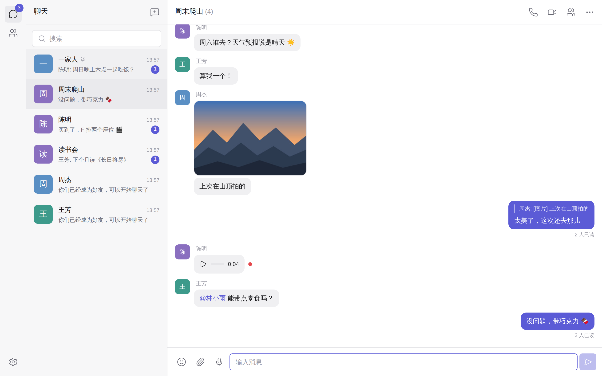
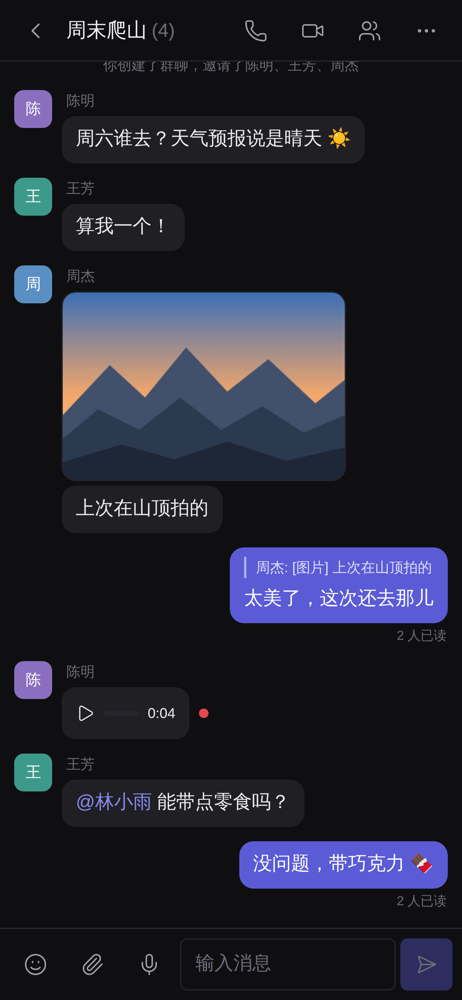
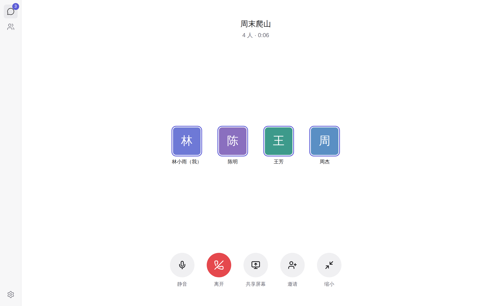
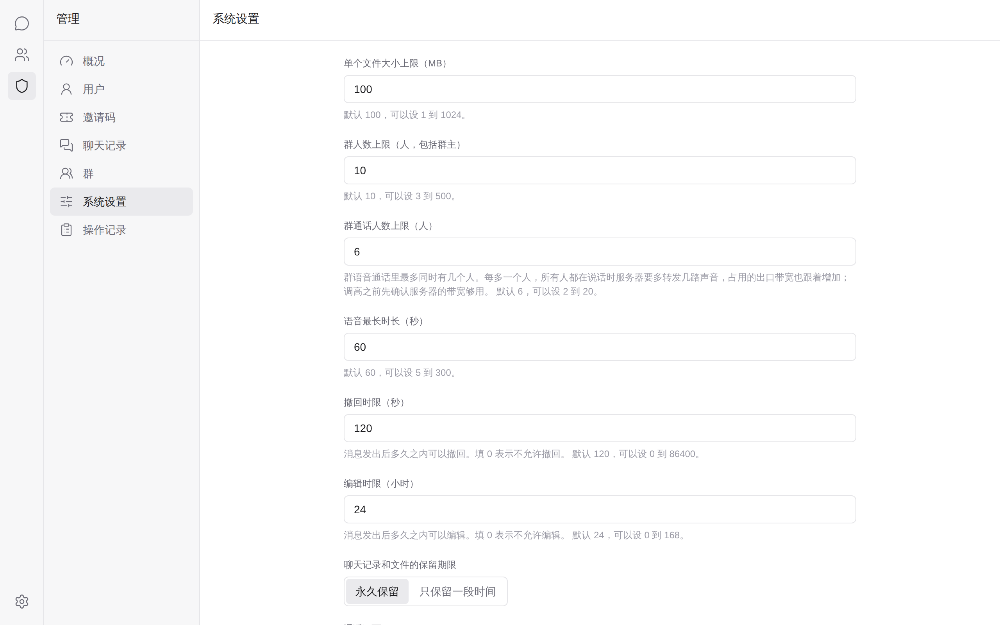

# VibeChat

[English](README.md)

一个可以自己部署的即时通讯应用：在自己的服务器上运行，凭邀请码注册，网页和桌面客户端都能用。
后端是 Rust，前端是 React。

个人项目，随缘维护。欢迎拿去用、拿去改；问题和建议可以提 issue，但不保证回复和修复的时间。

<p></p>
<p>
  
  
</p>
<p></p>

## 能做什么

**聊天**

- 单聊、群聊；文字、表情、图片（可以带说明）、文件、语音消息
- 引用回复、转发、多选合并转发；撤回、编辑（管理员设定时限）；只从自己这里删除消息、清空聊天记录
- 群里 @ 某人、@ 所有人；已读人数；"正在输入"
- 会话置顶、搜索聊天记录、会话里的图片和文件一览
- 同一个账号可以同时在几台设备上登录，看得到登录着的设备，可以退出别的设备

**通话**（要 HTTPS，见部署说明）

- 一对一语音、视频通话，通话中可以在电脑上共享屏幕
- 群语音、群视频通话，通话中可以共享屏幕

**群和通讯录**

- 好友申请、备注、按首字母分组的通讯录
- 群主和最多 3 名管理员：邀请和移出成员、禁言、全员禁言、入群审批、群公告、转让群主、解散群

**管理**

- 管理员生成邀请码，别人凭邀请码注册
- 用户管理、查看聊天内容、群的管理、概况、操作记录
- 系统设置：文件大小、群人数、语音时长、撤回和编辑的时限、消息保存多久、通话画面的清晰度和码率等

**其他**

- 中文和英文界面，浅色和深色外观
- 电脑和手机上的 Chrome、Safari 都能用
- macOS 桌面客户端（Electron，Apple 芯片的 Mac）：新消息和来电的系统通知，在"设置 → 关于"里下载新版本
- 服务器上换了新版本时，已经开着的页面提示刷新，并告诉你更新了什么

## 没有的

- 手机上的原生应用。手机上用浏览器
- 页面关掉之后的推送：只有页面或桌面客户端开着的时候才收得到通知
- 消息的端到端加密：消息以明文存在你自己的服务器上（一对一通话的声音和画面是端到端加密的）
- Windows、Linux、Intel 芯片的 Mac 上的桌面客户端；Firefox 的支持

## 部署

在一台有公网 IP 的服务器上用 Docker 部署。只有 IP 时能聊天；有域名、用 HTTPS 时全部功能都能用。
见 [部署说明](docs/deploy.md)。

部署说明还没有在一台全新的服务器上从头验证过；照着做遇到问题，欢迎提 issue。

## 截图

上面的截图由 `./scripts/screenshots`（在宿主机上、仓库根目录执行）生成：自动造好示例数据，中英文各截一套。改了界面之后可以重新截。

## 目录

```
server/    Rust 的 cargo workspace
  crates/protocol    HTTP 和 WebSocket 的消息类型，导出 TS
  crates/core        业务逻辑；定义 Store、BlobStore trait
  crates/infra       trait 的实现（数据库、文件存储、发邮件）
  crates/migration   数据库迁移
  crates/app         可执行程序 vibechat-server
client/    pnpm workspace
  apps/web           网页（Vite）
  apps/desktop       macOS 桌面客户端（Electron）
  packages/protocol  生成的 TS 类型
  packages/core      连接、同步、状态管理、通话
  packages/ui        React 界面
  e2e                端到端测试（Playwright）
deploy/    部署用的 Dockerfile、compose 文件和配置
dev/       开发环境的 Dockerfile 和配置
docs/      部署说明、README 里的截图
scripts/   开发脚本
data/      开发时的运行数据（SQLite、上传的文件），不进 git
```

代码注释里常见 F12、M2 这样的编号：那是开发时的任务编号，对应的需求和设计文档没有公开。

## 开发环境

所有命令都在开发容器里执行，宿主机只需要 Docker（带 compose）和 git。开发环境的定义在仓库里：
根目录的 `compose.yaml`，以及 `dev/` 下的 Dockerfile、coturn 和 LiveKit 的配置。

```bash
# 在仓库根目录：构建并启动开发容器（第一次要下载和编译，需要一些时间）
docker compose up -d --build

# 同时启动后端和前端（第一次会先装前端的依赖）。改 Rust 代码后端自动重启，改前端代码页面热更新
docker compose exec dev ./scripts/dev

# 要试一对一和群通话时，另外启动中转服务（coturn）和媒体转发服务（LiveKit）
docker compose --profile calls up -d
```

| 地址 | 内容 |
|---|---|
| http://127.0.0.1:8780 | 网页（Vite，`/api`、`/ws`、`/livekit` 转给后面的服务） |
| http://127.0.0.1:8788 | Rust 后端 |

请用 `127.0.0.1` 而不是 `localhost` 打开：服务端按 `PUBLIC_URL` 校验请求的来源，两者不是同一个来源。
第一名管理员是 `admin`，初始密码 `change-me-1`（见 `compose.yaml`），第一次登录后要改密码。

开发镜像要下载 Rust、Node 和 watchexec。网络不好时可以先手动下好放进 `dev/downloads/`，见 `dev/Dockerfile` 开头的说明。

端口、通话用的地址可以在仓库根目录的 `.env` 里改（不进 git），例如：

```bash
VC_WEB_PORT=8780        # 网页的端口
VC_API_PORT=8788        # 后端的端口
VC_BIND=127.0.0.1       # 端口绑在哪个地址上
VC_HOST_IP=192.168.1.10 # 浏览器连通话服务用的地址；从别的电脑、手机上试通话时要设成这台机器在局域网里的地址
```

## 检查和测试

```bash
# 提交前的检查：格式、静态检查、类型、单元测试。数据层只在 SQLite 上跑
docker compose exec dev ./scripts/check

# 全量测试（在仓库根目录，宿主机上执行）：上面的全部内容，加上数据层在 PostgreSQL 上的测试，
# 以及 Chrome、Safari 两种浏览器内核里的端到端测试
./scripts/test-all

# 只跑一种内核的端到端测试
./scripts/test-all --e2e-only --project=webkit

# 只跑端到端测试，后面的参数传给 Playwright
./scripts/test-all --e2e-only -g "avatar"
```

全量测试会临时启动测试用的 PostgreSQL、coturn、LiveKit 和端到端测试容器，以及一套独立的前后端，
结束后自动清理，不影响正在运行的开发环境。第一次要先构建端到端测试的镜像：`docker compose --profile test build e2e`。

## 常用命令

```bash
# 修改 server/crates/protocol 后，重新生成 TS 类型
docker compose exec dev ./scripts/gen-protocol

# 整理前端代码的格式
docker compose exec -w /vibechat/client dev pnpm format

# 整理后端代码的格式
docker compose exec -w /vibechat/server dev cargo fmt
```

桌面客户端怎么编译、打包，见 [client/apps/desktop/README.md](client/apps/desktop/README.md)。

## 服务端的配置

服务端的配置全部来自环境变量，启动时校验，有问题会指出是哪一项。空着的等于没有设置。

| 配置 | 必填 | 含义 |
|---|---|---|
| `PUBLIC_URL` | 是 | 用户在浏览器里访问系统的地址，用于校验请求的来源 |
| `DATABASE_URL` | 是 | 数据库连接，`sqlite:` 或 `postgres:` 开头 |
| `FILES_DIR` | 是 | 上传的文件存放的本地目录，不存在时自动创建 |
| `ADMIN_EMAIL`、`ADMIN_INITIAL_PASSWORD` | 首次启动时 | 数据库里还没有管理员时，用它们创建第一名管理员。两项要一起设置；已经有管理员之后不再起作用 |
| `LISTEN_ADDR` | 否 | 监听地址，默认 `0.0.0.0:3488` |
| `TRUSTED_PROXIES` | 否 | 反向代理的地址，多个用逗号分隔。只有来自这些地址的请求，才采信其中关于用户真实地址的请求头 |
| `LOGINS_PER_MINUTE`、`REGISTRATIONS_PER_MINUTE`、`PASSWORD_RESETS_PER_MINUTE` | 否 | 同一来源地址每分钟允许的登录、注册、找回密码的次数 |
| `SMTP_URL`、`MAIL_FROM` | 否 | 发信服务（`smtp://` 或 `smtps://`）和发件人。不设时邮件写进 `MAIL_DIR` |
| `MAIL_DIR` | 否 | 没有发信服务时邮件写在哪里，默认是 `FILES_DIR` 旁边的 `mail` |
| `DESKTOP_DIR` | 否 | 桌面客户端的安装包放在哪里，默认是 `FILES_DIR` 旁边的 `desktop` |
| `DESKTOP_MIN_VERSION` | 否 | 桌面客户端的最低版本，更旧的会被要求更新 |
| `TURN_URLS`、`TURN_SECRET` | 否 | 一对一通话的中转服务（coturn）的地址和共享密钥。不设就没有一对一通话 |
| `LIVEKIT_URL`、`LIVEKIT_API_KEY`、`LIVEKIT_API_SECRET` | 否 | 群通话的媒体转发服务（LiveKit）。不设就没有群通话 |
| `LOG_LEVEL` | 否 | 日志级别，默认 `info` |

## 许可证

[MIT](LICENSE)
